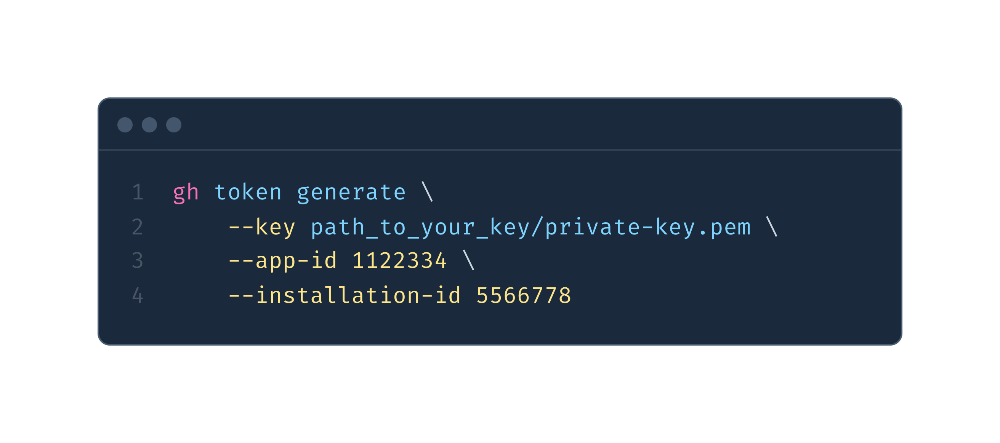
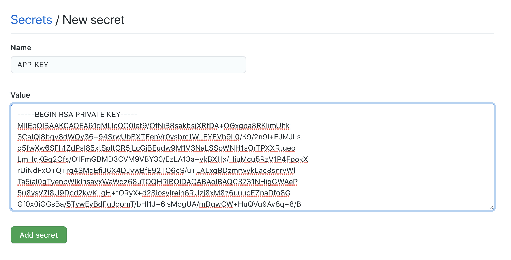

# GH Token

```shell
* _____ _   *_   _______ *  _      *  *    **   *
 / ____| |* | | |__   __|  | |  *       *         🦄  *
| | *__| |_*| | ⭐️ | | ___ | | _____*_ __  *     *
| | |_ |* __ *|    |*|/ _ \| |/ / _ \ '_ \     *   *
| |__| | |  | | *  | | (_)*|   <  __/ | | |  *
 \_____|_|  |_|    |_|\___/|_|\_\___|_| |_|   *
```

<!-- markdownlint-disable -->

> Manage installation access tokens for GitHub apps from your terminal

[](LICENSE)

<!-- markdownlint-restore -->

[Creates an installation access token](https://docs.github.com/en/rest/reference/apps#create-an-installation-access-token-for-an-app) to make authenticated API requests.

Installation tokens expire **1 hour** from the time you create them. Using an expired token produces a status code of `401 - Unauthorized`, and requires creating a new installation token.

You can use this access token to make pretty much any REST or GraphQL API call the app is authorized to make!



## Why?

In order to use GitHub's [REST](https://docs.github.com/en/rest) or [GraphQL](https://docs.github.com/en/graphql) APIs you will need either a [Personal Access Token](https://docs.github.com/en/developers/apps/about-apps#personal-access-tokens) (PAT) or a [GitHub App](https://docs.github.com/en/developers/apps/about-apps#about-github-apps).

**PATs are dangerous, they:**

1. have a very wide scope that spans across multiple organizations
1. never (automatically) expire. They have an indefinite lifetime (or at least until you regenerate them)
1. cannot be revoked (they're only revoked when a new one is generated)

With an access token generated with a GitHub App you don't have to worry about the concerns above. These tokens have a limited scope and lifetime. Just make sure you handle the token safely (avoid leaking). In the worst case scenario, the token will expire in **1 hour from creation time.**

## Installation

### Download as a standalone binary

Download `gh-token` from the [latest release](https://github.com/Link-/gh-token/releases/latest) for your platform.

### Install as a `gh` cli extension

You can install `gh-token` as a [gh cli](https://github.com/cli/cli) extension!

```shell
$ gh extension install Link-/gh-token

# Verify installation
$ gh token
```

All the commands and parameters remain the same, the only different is you now can use `gh token` instead of `gh-token`.

### Creating a GitHub App

Follow [these steps](https://docs.github.com/en/developers/apps/creating-a-github-app)

## Usage

Compatible with [GitHub Enterprise Server](https://github.com/enterprise).

```text
NAME:
   gh-token - Manage GitHub App installation tokens

USAGE:
   gh-token [global options] command [command options] [arguments...]

VERSION:
   2.0.2

COMMANDS:
   generate       Generate a new GitHub App installation token
   revoke         Revoke a GitHub App installation token
   installations  List GitHub App installations
   help, h        Shows a list of commands or help for one command

GLOBAL OPTIONS:
   --help, -h     show help
   --version, -v  print the version
```

### Examples in the Terminal

#### Run `gh token` as a `gh` CLI extension

```shell
gh token generate \
    --key ./.keys/private-key.pem \
    --app-id 1122334 \
    --installation-id 5566778
```

```json
{
  "token": "ghs_8Joht_______________bLCMS___M0EPOhJ",
  "expires_at": "2023-09-08T18:11:34Z",
  "permissions": {
    "actions": "write",
    "administration": "write",
    "metadata": "read",
    "members": "read",
    "organization_administration": "read"
  }
}
```

#### Run `gh token` and pass the key as a base64 encoded string

```shell
gh token generate \
    --base64-key $(printf "%s" $APP_KEY | base64) \
    --app-id 1122334 \
    --installation-id 5566778
```

```json
{
  "token": "ghs_8Joht_______________bLCMS___M0EPOhJ",
  "expires_at": "2023-09-08T18:11:34Z",
  "permissions": {
    "actions": "write",
    "administration": "write",
    "metadata": "read",
    "members": "read",
    "organization_administration": "read"
  }
}
```

#### Run `gh token` with GitHub Enterprise Server

```shell
gh token generate \
    --base64-key $(printf "%s" $APP_KEY | base64) \
    --app-id 1122334 \
    --installation-id 5566778 \
    --hostname "github.example.com"
```

```json
{
  "token": "ghs_8Joht_______________bLCMS___M0EPOhJ",
  "expires_at": "2023-09-08T18:11:34Z",
  "permissions": {
    "actions": "write",
    "administration": "write",
    "metadata": "read",
    "members": "read",
    "organization_administration": "read"
  }
}
```

#### Fetch list of installations for an app

```shell
gh token installations \
    --key ./private-key.pem \
    --app-id 2233445
```

<details>
  <summary>Response</summary>

  ```json
  [
    {
      "id": 1,
      "account": {
        "login": "octocat",
        "id": 1,
        "node_id": "MDQ6VXNlcjE=",
        "avatar_url": "https://github.com/images/error/octocat_happy.gif",
        "gravatar_id": "",
        "url": "https://api.github.com/users/octocat",
        "html_url": "https://github.com/octocat",
        "followers_url": "https://api.github.com/users/octocat/followers",
        "following_url": "https://api.github.com/users/octocat/following{/other_user}",
        "gists_url": "https://api.github.com/users/octocat/gists{/gist_id}",
        "starred_url": "https://api.github.com/users/octocat/starred{/owner}{/repo}",
        "subscriptions_url": "https://api.github.com/users/octocat/subscriptions",
        "organizations_url": "https://api.github.com/users/octocat/orgs",
        "repos_url": "https://api.github.com/users/octocat/repos",
        "events_url": "https://api.github.com/users/octocat/events{/privacy}",
        "received_events_url": "https://api.github.com/users/octocat/received_events",
        "type": "User",
        "site_admin": false
      },
      "access_tokens_url": "https://api.github.com/installations/1/access_tokens",
      "repositories_url": "https://api.github.com/installation/repositories",
      "html_url": "https://github.com/organizations/github/settings/installations/1",
      "app_id": 1,
      "target_id": 1,
      "target_type": "Organization",
      "permissions": {
        "checks": "write",
        "metadata": "read",
        "contents": "read"
      },
      "events": [
        "push",
        "pull_request"
      ],
      "single_file_name": "config.yaml",
      "has_multiple_single_files": true,
      "single_file_paths": [
        "config.yml",
        ".github/issue_TEMPLATE.md"
      ],
      "repository_selection": "selected",
      "created_at": "2017-07-08T16:18:44-04:00",
      "updated_at": "2017-07-08T16:18:44-04:00",
      "app_slug": "github-actions",
      "suspended_at": null,
      "suspended_by": null
    }
  ]
  ```

</details>

#### Revoke an installation access token

```shell
gh token revoke \
    --token "v1.bb1___168d_____________1202bb8753b133919" \
    --hostname "github.example.com"
```

```text
Successfully revoked installation token
```

### Example in a workflow

<details>

  <summary>Expand to show instructions</summary>

1. You need to create a secret to store the **applications private key** securely (this can be an organization or a repository secret):
    

1. You need to create another secret to store the **application id** security (same as the step above).

1. The secrets need to be provided as an environment variable then encoded into base64 as show in the workflow example:

This example is designed to run on GitHub Enterprise Server. To use the same workflow with GitHub.com update the hostname to `api.github.com` and change the API URL in the testing step.

```yaml
name: Create access token via GitHub Apps Workflow

on:
  workflow_dispatch:

jobs:
  Test:
    # The type of runner that the job will run on
    runs-on: [ self-hosted ]

    steps:
    - name: "Install gh-token"
      run: gh extension install Link-/gh-token
    # Create access token with a GitHub App ID and Key
    # We use the private key stored as a secret and encode it into base64
    # before passing it to gh-token
    - name: "Create access token"
      run: |
        token=$(gh token generate \
          --base64-key $(printf "%s" "$APP_PRIVATE_KEY" | base64 -w 0) \
          --app-id $APP_ID \
          --hostname "github.example.com" \
          | jq -r ".token")
        echo "token=$token" >> $GITHUB_OUTPUT
      env:
        APP_ID: ${{ secrets.APP_ID }}
        APP_PRIVATE_KEY: ${{ secrets.APP_KEY }}
    # To test the token we will use it to fetch the list of repositories
    # belonging to our organization
    - name: "Fetch organization repositories"
      run: |
        curl -X GET \
          -H "Authorization: token $token" \
          -H "Accept: application/vnd.github.v3+json" \
          https://github.example.com/api/v3/orgs/<ORGNAME>/repos
```

</details>

## Downscoped tokens

By default `gh token generate` mints a token for the **whole installation**: every repository and every permission the App has. To give a script or an AI agent less than that, declare the repositories and permissions it needs, in the same format GitHub Codespaces uses in `devcontainer.json`. GitHub can only narrow a token, never widen it beyond the installation.

```shell
gh token generate \
    --app-id 1122334 \
    --key ./private-key.pem \
    --scope-file examples/agent-fork-scope.json
```

Where [`examples/agent-fork-scope.json`](examples/agent-fork-scope.json) is:

```json
{
  "repositories": {
    "my-user/some-fork": {
      "permissions": {
        "contents": "write",
        "workflows": "write",
        "actions": "write",
        "checks": "read"
      }
    }
  }
}
```

`--scope-file` (`-f`) takes either a plain file with `repositories`, or a whole `devcontainer.json` with `customizations.codespaces.repositories`; comments and trailing commas are fine. Keys are `owner/repo` or `owner/*`. Permissions are a map of [permission name](https://docs.github.com/en/rest/apps/apps#create-an-installation-access-token-for-an-app) to `read`, `write` or `admin`, or the shorthands `read-all` and `write-all`.

The installation is looked up from the repositories' owner, so `--installation-id` isn't needed. Check what would be requested without minting anything:

```shell
$ gh token generate -i 1122334 -k ./private-key.pem -f examples/agent-fork-scope.json --print-request
# installation: 5566778 (looked up for my-user)
# repository: my-user/some-fork (scope file)
{"repositories":["some-fork"],"permissions":{"actions":"write","checks":"read","contents":"write","workflows":"write"}}
```

For one-off use, skip the file:

```shell
gh token generate -i 1122334 -k ./private-key.pem \
    -r my-org/app -r my-org/lib \
    -p contents=write -p pull_requests=write
```

### How a scope becomes a token

An installation token belongs to one installation and carries **one** permission set for all its repositories. Codespaces can give each repository its own permissions; a single token can't, so `gh token` refuses rather than silently widening access:

| Scope | Result |
| --- | --- |
| Repositories under more than one owner | Error. Split the file, or run once per owner. |
| `owner/*` | All repositories in the installation. Specific repositories of the same owner only add permissions, with a warning. |
| All repositories declare identical permissions | Used as is. |
| Repositories declare different permissions | Error listing each repository's permissions, unless `--merge-permissions` is set. |
| `--merge-permissions` | Union of all permissions, highest level wins, with a warning for every repository that gets more than it declared. |
| `write-all` | The installation's permissions, unchanged. |
| `read-all` | Every installation permission at `read` (write-only permissions such as `workflows` are left out). |

> [!WARNING]
> `--merge-permissions` widens access: every repository in the token gets the union of the declared permissions. Prefer identical permission sets, or separate tokens.

After minting, the token's permissions and repositories are compared with the request and any difference is printed as a warning on stderr (`--silent` hides warnings). Failed requests include GitHub's error message, which names the rejected repository or permission.

### Downscoping flags

| Flag | Description |
| --- | --- |
| `--scope-file`, `-f` | Scope file or `devcontainer.json`. |
| `--repository`, `-r` | `owner/repo`, or a bare `repo` with `--installation-id`. Repeatable. Not combinable with `--scope-file`. |
| `--permission`, `-p` | `name=level`, `read-all` or `write-all`. Repeatable. With `--scope-file` it only supplies the current repository's permissions. |
| `--merge-permissions` | Accept differing permissions by merging them (widens access). |
| `--print-request` | Print the installation ID and request body, then exit. |
| `--verify-installation` | With `--installation-id`, check it matches the scope's owner. |
| `--current-repo`, `-c` | Add the clone's own repository from its git remote. On by default for `devcontainer.json` files. |
| `--git-dir`, `--git-remote` | Clone (default `.`) and remote (default `origin`) to read. |
| `--output-file` | Write the token atomically to a file (mode `0600`) instead of stdout, plus metadata (no token) to `<file>.json`. |
| `--refresh` | With `--output-file`, keep running and re-mint before expiry. |
| `--refresh-before` | How long before expiry to re-mint (default `10m`). |
| `--revoke-on-exit` | With `--refresh`, revoke the current token on SIGINT or SIGTERM. |
| `--pid-file` | With `--refresh`, don't start a second refresher with the same scope. |

### The current repository

Like Codespaces, the clone's own repository can be included without naming it, so the same `.devcontainer` works in every clone and fork. With `--current-repo` (implied for `devcontainer.json` files, disable with `--current-repo=false`) the repository is read with `git remote get-url origin` and must be on the same host as `--hostname`. Its permissions come from, in order:

1. an entry for it under `repositories`;
2. `customizations.gh-token.currentRepository.permissions` in `devcontainer.json`;
3. `--permission` flags;
4. an `owner/*` entry covering it;

otherwise it's an error. There is deliberately no default permission set. The simplest local use needs no file at all:

```shell
gh token generate -i 1122334 -k ./private-key.pem --current-repo -p contents=write -p pull_requests=write
```

## Using with a local devcontainer

GitHub Codespaces gives the code in a codespace a token scoped to what `devcontainer.json` declares. A local devcontainer (VS Code Dev Containers, `devcontainer up`) has nothing like it, so an agent inside it, for example Claude Code, would otherwise need a broad personal token. [`contrib/devcontainer/`](contrib/devcontainer/) reproduces the Codespaces behaviour:

| Where | What |
| --- | --- |
| Host, `initializeCommand` | [`host-init.sh`](contrib/devcontainer/host-init.sh) starts `gh token generate --scope-file .devcontainer/devcontainer.json --output-file <dir>/token --refresh --pid-file <dir>/pid` in the background, logging to `<dir>/refresh.log`, and waits up to 30 seconds for a fresh token. The App's private key stays on the host. |
| `mounts` | The token directory is bind-mounted read-only at `/run/gh-token`. |
| Container, `postCreateCommand` | [`post-create.sh`](contrib/devcontainer/post-create.sh) installs a `gh` shim and a git credential helper that read `/run/gh-token/token` on every call, then runs `gh repo set-default` for `origin`. |

### Setup

1. Create a GitHub App with the permissions your agents may ever need, and install it on the repositories (or the organization) you'll work on.
1. On the host, install the extension and point it at the App:

    ```shell
    gh extension install Link-/gh-token
    export GH_TOKEN_APP_ID=1122334
    export GH_TOKEN_KEY=$HOME/.config/gh-token/private-key.pem
    # GitHub Enterprise Server only:
    export GH_TOKEN_HOSTNAME=github.example.com
    ```

    `initializeCommand` inherits the environment of the process that starts the container, so set these where VS Code or the `devcontainer` CLI will see them (for example your shell profile, then start VS Code from that shell).
1. Copy `contrib/devcontainer/*.sh` into `.devcontainer/gh-token/` in your repository.
1. Add the wiring and the scope to `.devcontainer/devcontainer.json`. See [`examples/devcontainer.json`](examples/devcontainer.json) (the clone's repository plus one extra, with identical permissions) and [`contrib/devcontainer/devcontainer.example.jsonc`](contrib/devcontainer/devcontainer.example.jsonc):

    ```jsonc
    {
      "features": { "ghcr.io/devcontainers/features/github-cli:1": {} },
      "initializeCommand": "bash .devcontainer/gh-token/host-init.sh \"${localEnv:HOME}/.cache/gh-token/${devcontainerId}\"",
      "mounts": [
        // mount the directory: atomic renames are only visible through a directory mount
        "source=${localEnv:HOME}/.cache/gh-token/${devcontainerId},target=/run/gh-token,type=bind,readonly"
      ],
      "postCreateCommand": "bash .devcontainer/gh-token/post-create.sh",
      "customizations": {
        "codespaces": {
          "repositories": {
            "my-org/shared-charts": { "permissions": { "contents": "write", "pull_requests": "write" } }
          }
        },
        "gh-token": {
          // permissions for the clone's own repository
          "currentRepository": { "permissions": { "contents": "write", "pull_requests": "write" } }
        }
      }
    }
    ```

1. In your VS Code **user** settings, turn off forwarding of the host's git credentials into containers: `"dev.containers.gitCredentialHelperConfigLocation": "none"`.

1. Open the folder in the container. Inside it, `gh` commands such as `gh pr create`, and `git push`, use the scoped token.

The [devcontainer specification](https://containers.dev/implementors/json_reference/#variables-in-devcontainerjson) substitutes `${devcontainerId}` in both `initializeCommand` and `mounts`, so the host-side directory and the mount source are the same path. If your tool doesn't substitute it, `host-init.sh` falls back to `${XDG_RUNTIME_DIR:-$HOME/.cache}/gh-token/<hash of the workspace path>` and prints the path; use that fixed path as the mount source instead. `${localEnv:HOME}` is empty on Windows hosts; use `${localEnv:USERPROFILE}` there.

Different permissions for the clone and the extra repositories (for example `contents: write` on the clone but `contents: read` on a shared repository) can't be expressed in one token. Either align them as above, or accept the union by adding `--merge-permissions` to the command in `host-init.sh`, knowing every listed repository then gets the wider set.

### Integration test

The [Scoped Token Integration](.github/workflows/integration-scoped.yml) workflow checks all of this against the real API, on pull requests from the same repository and on manual runs. It needs the `APP_ID` and `APP_PRIVATE_KEY` repository secrets (`APP_ID` may also be a repository variable) for an App installed on the repository with Metadata read, Contents read, and Pull requests read and write. It:

- mints a token for the current repository and checks the request, the token's repositories and permissions, that out-of-scope writes get a 403, and that revoking works;
- starts a real devcontainer with `devcontainer up` and a scope of `contents: read` and `pull_requests: write`, then runs [`in-container.sh`](contrib/devcontainer/tests/in-container.sh) inside it: the App's private key is not in the container, `gh` and git use the token, pushing is refused, the token has exactly the declared permissions on this repository only, and commenting on the pull request works (the comment is deleted right away).

### Refresh

Installation tokens expire after one hour. The refresher re-mints the token 10 minutes before expiry and atomically replaces the file; on failure it keeps the old token and retries with backoff (at most every 5 minutes). The shim and credential helper read the file on every call, so nothing in the container needs restarting. `initializeCommand` runs on every container start: if a refresher with the same scope is already running it is reused, if it has a different scope (you changed `devcontainer.json`) `host-init.sh` fails and asks you to stop it.

The refresher keeps running after the container stops. Stop it with:

```shell
kill "$(head -n 1 ~/.cache/gh-token/<devcontainerId>/pid)"
```

The scope is read **once**, when the refresher starts. Later refreshes reuse the same request and never re-read `devcontainer.json` or the git remote: the agent can edit files in the workspace, and that must not widen the next token. This is a security property, not an oversight.

### Security notes

- The agent can read the token; it is meant to use it. The protection is that the token is limited to the declared repositories and permissions, expires within the hour, and the App's private key never enters the container.
- The token directory must be outside the workspace, or the agent could commit it. `host-init.sh` refuses a directory inside the workspace.
- `initializeCommand` runs whatever is in the repository's `.devcontainer` **on the host**, and the scope is read from the workspace when the container starts. An agent that edits `.devcontainer/devcontainer.json` can widen the scope of the *next* start. Only use this with repositories you trust, review changes to `.devcontainer/`, and consider keeping the scripts and the scope outside the repository (`GH_TOKEN_SCOPE_FILE=/path/outside/repo.json`).
- Don't run `gh auth login` in the container. The shim sets `GH_TOKEN` (or `GH_ENTERPRISE_TOKEN` for GitHub Enterprise Server), which takes precedence, and removes any other token variables from `gh`'s environment.
- Turn off VS Code's forwarding of host git credentials (`dev.containers.gitCredentialHelperConfigLocation: none` in your user settings). `post-create.sh` also resets the helper list for the GitHub host so its helper answers first, but a forwarded helper configured later could still be asked when no token is available. SSH remotes for that host are rewritten to https so pushes don't use a forwarded SSH agent; consider disabling SSH agent forwarding too.
- The token directory is `0700` and owned by your host user. On Linux the container user must have the same UID (the devcontainer default `updateRemoteUserUID` handles this); Docker Desktop on macOS doesn't enforce host ownership.
- The App must be installed on the clone's repository (or its owner, with access to the repository). Otherwise the lookup returns 404 and `host-init.sh` says so.

## Agent on a fork

An agent can develop and validate a GitHub Actions workflow on your fork of a public repository, then a **human** opens the pull request upstream. An installation token can't create pull requests on a repository where the App isn't installed, and that step is deliberately left to a person.

1. Install the App on the fork (or on "All repositories" of your account).
1. Enable Actions on the fork by hand (forks start with workflows disabled). Doing it by hand avoids granting the agent the `administration` permission.
1. Scope the token to the fork, for example with [`examples/agent-fork-scope.json`](examples/agent-fork-scope.json), or in `devcontainer.json`:

    ```jsonc
    "customizations": {
      "gh-token": {
        "currentRepository": {
          "permissions": { "contents": "write", "workflows": "write", "actions": "write", "checks": "read" }
        }
      }
    }
    ```

1. Clone with `origin` pointing at the fork and `upstream` at the original. `gh` may resolve commands to `upstream`, which the token can't reach; `post-create.sh` runs `gh repo set-default <owner>/<fork>` for you (or run it yourself).
1. The agent pushes a branch, then runs `gh workflow run`, `gh run watch` and `gh run view --log`.
1. You open the pull request to upstream.

## Similar projects

_These are not endorsements, just a listing of similar art work_

### CLI

- [apptokit](https://github.com/jakewilkins/apptokit) in Ruby
- [gha-token](https://github.com/slawekzachcial/gha-token) in Go

### Actions

- [create-github-app-token](https://github.com/actions/create-github-app-token) (GitHub official)
- [workflow-application-token-action](https://github.com/peter-murray/workflow-application-token-action)
- [action-github-app-token](https://github.com/getsentry/action-github-app-token)
- [github-app-token-generator](https://github.com/navikt/github-app-token-generator)
